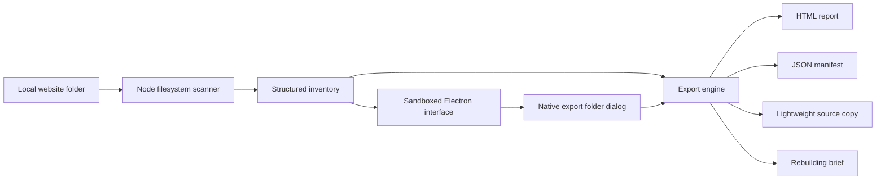

# PageTrace: architecture and development

PageTrace is a local desktop application for **offline website analysis, HTML structure inspection, asset inventory, AI context extraction, and website reconstruction planning**. It does not run a web server or require a cloud service.

## Components



| Component                   | Responsibility                                                                                          |
| --------------------------- | ------------------------------------------------------------------------------------------------------- |
| `src/main.cjs`              | Owns the window, native dialogs, current scan, cancellation, sample lifetime, and last-export location. |
| `src/preload.cjs`           | Exposes only `scan`, `sample`, `cancel`, `export`, `openExport`, and progress subscription.             |
| `src/scanner.cjs`           | Inventories files, parses small source files, classifies references, and writes independent exports.    |
| `src/renderer.js`           | Renders safe text, navigation, search, filtering, sorting, file inspection, and outline controls.       |
| `src/theme.js`              | Applies Light/Dark/Auto before styles load and persists the selected mode.                              |
| `src/style.css`             | Shared layout, responsive sizing, typography, and controls.                                             |
| `src/appearance.css`        | White/emerald and dark-green design tokens and surface overrides.                                       |
| `src/sample.cjs`            | Creates a temporary example site with sparse, non-playable media fixtures.                              |
| `scripts/desktop-smoke.cjs` | Drives the real desktop interface and captures documentation screenshots.                               |

## Data flow and performance

The scanner walks directory entries asynchronously. It records media sizes using filesystem metadata rather than decoding or loading media. Recognized text source files up to **2 MiB** are read and parsed; larger source files are retained without parsing. The resulting inventory is held in memory, so a source tree with very large numbers of files can still consume substantial memory even if its media is never loaded.

HTML is parsed using parse5. Page records contain titles, headings, content excerpts, metadata, semantic-element counts, and a nested outline. The outline is bounded to avoid unbounded UI rendering. Supported static references are resolved against an inventory of known paths. External URLs are classified but never fetched.

The UI limits the visible file table to **500 matching rows**, page cards to **200 pages**, and displayed warnings/exclusions to bounded lists. The exported manifest retains the full inventory, subject to individual parsing limits. These display caps do not change export decisions.

Export copies retained files into a fresh directory outside the input folder. It checks file size, modification time, and available parsed-source hashes before copying. A changed or unreadable file is omitted with an export warning. This is not an atomic snapshot: use a trusted, stable input copy and do not edit it during analysis/export.

## Appearance

- Brand accent: **`#00674F`**.
- Light mode: white main surfaces and pale emerald navigation/selected states.
- Dark mode: deep green surfaces, the same primary-button color, and lighter emerald text accents for readability.
- Auto mode: follows `prefers-color-scheme`, including system changes while running.
- Preference: `pagetrace.appearance` in Electron renderer local storage; valid values are `light`, `dark`, and `system`.
- Invalid/unavailable saved preferences fall back to Auto. No account is needed.
- Reduced-motion preferences disable transitions and animation.

## Security boundary

The main process controls filesystem access. IPC requests are restricted to the application’s main frame. The renderer has Node integration disabled, context isolation enabled, and Chromium sandboxing enabled during normal use. The preload exposes no arbitrary filesystem or shell execution API.

The content policy permits local application scripts/styles and blocks network connections. Navigation and new windows are blocked. Website content is inserted as text; the application never loads an inspected website into the Electron window. Exported reports escape text and forbid scripts through their own content policy.

Known credential filenames, symlinks, dependencies, and caches are excluded. This does not detect secrets embedded in ordinary code or all unusual credential filenames. Lightweight source is not sanitized for safe execution. Inspect exports before running or sharing them.

## Run and validate

```sh
npm ci
npm test
npm start
```

Node.js **22.12 or newer** is required. Electron installation uses its bundled expected checksums; do not bypass artifact or TLS verification.

```sh
npm run test:desktop
# Linux CI / isolated container with Xvfb:
xvfb-run -a npm run test:desktop:ci
# Refresh the illustrated guide images:
xvfb-run -a npm run test:desktop:ci -- --screenshots
```

The CI-specific script disables Chromium’s sandbox only for the isolated Linux test process because hosted runners restrict user namespaces. Normal `npm start` and shipped executables keep sandboxing enabled.

Desktop checks exercise actual IPC scans/exports, validation, filters, sorting, the inspector, keyboard search, outline controls, theme persistence across reload, dark surface colors, exact brand color, compact-window layout, the offline guide, and sample scanning.

## Windows builds and downloads

```sh
npm run dist:win
```

Builds both `PageTrace-VERSION-x64-Setup.exe` and `PageTrace-VERSION-x64-portable.exe`. Native Windows is the standard release platform. Linux cross-builds can produce the portable executable; the installer’s uninstaller-generation step requires a working Wine toolchain, which may be unavailable in a Linux container.

The **Windows executable** workflow runs native Windows tests and desktop interactions, packages the app, and publishes a GitHub Release with:

- `PageTrace-Windows-x64.exe`: stable portable-download filename.
- `PageTrace-VERSION-x64-Setup.exe`: installer.
- `SHA256SUMS.txt`: SHA-256 hashes of the downloadable files.

The release step needs the workflow’s explicitly declared `contents: write` permission. It uses GitHub’s injected workflow token, not a personal token. Repository visibility is unchanged. For a private repository, users must have access to download releases.

Do not commit executables or dependency/build caches into the source tree. Increment the package version before a new public release. The workflow uses that version as its release tag. Builds are currently unsigned and have no auto-update service.

## Scope boundaries

PageTrace is a source-analysis and reconstruction tool. Browser rendering, site compilation, crawling live websites, arbitrary custom per-file export selections, archive extraction, media transcoding, and pixel-perfect cloning are outside this version’s workflow. Improvements should preserve the default offline behavior and the original input folder.
