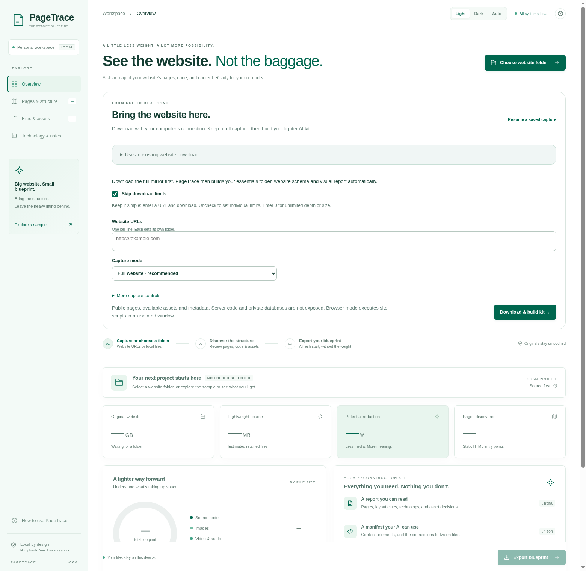
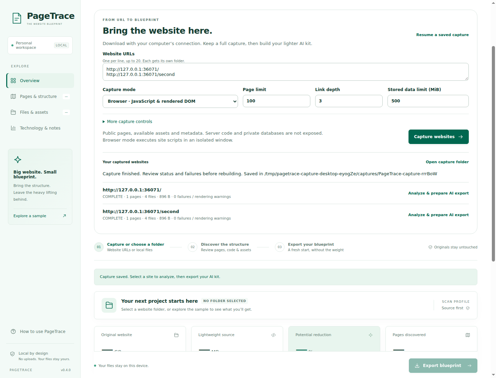
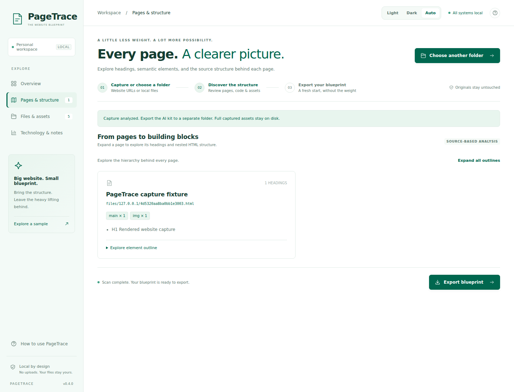

# Capture websites with PageTrace

The default **Full website** mode includes its download engine inside PageTrace and automatically produces the essentials folder, schema, SVG diagram and report. No separate application, executable selection or terminal step is required. Its options and resume behavior are documented in [HTTRACK.md](HTTRACK.md). The implementation details and limits below describe the built-in Fast/Browser engines.

PageTrace can now download public websites before analyzing them. All capture traffic uses the desktop computer's internet connection. No PageTrace crawling server, Vercel function or cloud upload is required. The Windows app is the supported delivery target; a browser-only app is deferred.

## Start a capture

1. On Overview, paste complete HTTP(S) URLs, one per line.
2. Choose **Fast** for linked pages and assets, or **Browser** for JavaScript-rendered HTML and discovered network resource URLs.
3. Set the page count, link depth and stored-data budget. Under More capture controls, set file count, per-file size, delay, retries, URL include/exclude patterns and external assets.
4. Click **Download & build kit** and choose a destination. A unique project folder is created, with a separate numbered folder for each starting URL, including multiple URLs on the same host.
5. Watch saved files, bytes, pages, queued URLs and current URL. **Pause capture** cancels the active request and checkpoints the queue. Use **Resume a saved capture** and select the folder containing `project.json` to continue, including after restarting the app. An in-progress response restarts from the beginning; this is file-level resume, not HTTP Range resume.
6. Review each site's status and its `capture-report.html`. Click **Analyze & prepare AI export** for the desired site, then **Export blueprint**. The full media capture remains on disk.

The screenshots use a deterministic local HTTP fixture. Its JavaScript creates a heading and image at runtime. They are real app screenshots and functional-test evidence, not live-site benchmarks.

## Capture modes and boundaries

| Feature | Behavior |
| --- | --- |
| Multiple starting URLs | Separate site folders, sequential project processing |
| Page scope | Starting origin only; cross-origin page redirects are rejected |
| External assets | Optional; robots policy is checked separately for each origin |
| Discovery | HTML links, iframes, src/poster, responsive srcset, common lazy attributes, inline styles, CSS imports/URLs, static module imports, web manifest icons and sitemap URLs |
| Browser mode | Disposable Electron session with Chromium sandbox, no Node/preload, no stored login, no permissions, no popups/downloads; only GET/HEAD/OPTIONS requests |
| Browser settling | Four viewport scroll positions with bounded waits; 30-second render deadline and bounded response bytes / request count |
| Robots | Longest-path matching, Allow tie precedence, PageTrace-specific or wildcard groups; 404/410 robots means no declared rules; other policy-fetch failures block that origin |
| Redirects and retries | Up to 10 redirects, with scope/robots checks; bounded retries for network/server failures and 429; ordinary 4xx responses are not retried |
| Download limits | Page/file/depth limits, streamed per-file and aggregate stored-byte caps; decoded HTTP responses are stored |
| Local mirror | HTML, CSS, supported static JavaScript import specifiers and manifest icon references rewritten to saved hashed paths; unavailable links remain absolute |
| Metadata | Source/final URLs, MIME, bytes, selected HTTP cache headers, failures and URL-to-file mapping |
| Source size | Discovery and mirror rewriting up to 8 MiB per source file; larger source files are preserved unchanged. The separate scanner uses its existing 2 MiB parsing limit |
| Resume | Restores the pending queue with the original settings; already recorded URLs are not automatically refreshed or retried |

Stored-byte limits include downloaded originals and rendered DOM snapshots. The rewritten mirror is an additional disk copy. Browser mode also fetches page resources while rendering, so network traffic can exceed stored bytes. Browser resource URLs are fetched again for the durable original capture; session-dependent response bodies may differ. Delays apply between queued downloads, not every browser subrequest. Credentials and response cookies are not exported to the capture manifest.

## Output folders

| Path | Contents |
| --- | --- |
| `project.json` | Starting URLs, settings and numbered site folders |
| `<site>/original/files/` | Fetched response bodies, unchanged by mirror rewriting; HTTP content decoding still applies |
| `<site>/rendered/` | Optional JavaScript-generated DOM snapshots |
| `<site>/mirror/files/` | Working source copy with supported local links |
| `<site>/mirror/PAGETRACE-CAPTURE.json` | URL mapping and capture limitations carried into the AI export |
| `<site>/capture.json` | Persistent queue, settings, records and capture status |
| `<site>/capture-report.html` | Human-readable saved/failed/skipped URL inventory |
| `<site>/README.txt` | Folder explanation |

Status **complete** means the discovered queue finished under the chosen scope. It does not certify that every possible site state was discovered. **Partial** includes download/render/parsing warnings. **Limited** means a configured file/byte/page discovery boundary truncated work; depth and filters deliberately narrow discovery. **Paused** preserves pending work. A site without `/sitemap.xml` can report a failed optional metadata URL while its actual pages are saved.

## HTTrack comparison and explicit omissions

The design follows the core mirroring workflow described in [HTTrack's guide](https://www.httrack.com/HelpHtml/cmdguide.html), [interface documentation](https://www.httrack.com/html/step4.html), and [FAQ](https://www.httrack.com/html/faq.html). The optional Fast/Browser engines are independently implemented. Full website mode uses the bundled upstream HTTrack engine; the option omissions below refer to the Fast/Browser engines.

Implemented: multi-URL projects, linked-page/asset capture, scope and filters, depth/page/file/size budgets, retries, redirect handling, robots rules, local-link rewriting, persistent job resume, plus rendered DOM capture and PageTrace's AI export.

Not implemented: conditional ETag/Last-Modified updates, refresh/delete synchronization, authenticated sessions or cookie imports, custom proxy configuration, interactive form capture, custom headers, scheduling, HTTP Range resume, concurrency controls, global bandwidth throttling, HTTrack's legacy protocol/plugin options, and complete application replay. Use a new capture project to refresh a site.

Server-side source, databases, paywalled content, inaccessible APIs, computed URLs that are never requested, infinite scrolling, cross-origin frames, service workers and arbitrary interaction states cannot be guaranteed. Video streaming playlists may require additional segment discovery; a single media link is not a complete streaming archive. Captured client JavaScript is not backend source. Inspect and replace omitted media before reconstruction.

## Verification

`npm test` covers static capture and AI-export integration with local HTTP fixtures. `npm run test:capture:desktop` drives two browser-mode sites through the real desktop IPC, checks JavaScript-created headings/assets, analyzes the capture and reopens the persisted project after a renderer reload. `npm run test:desktop` preserves the existing scanner/export checks. Windows CI runs both desktop suites before packaging installer and portable executables.
