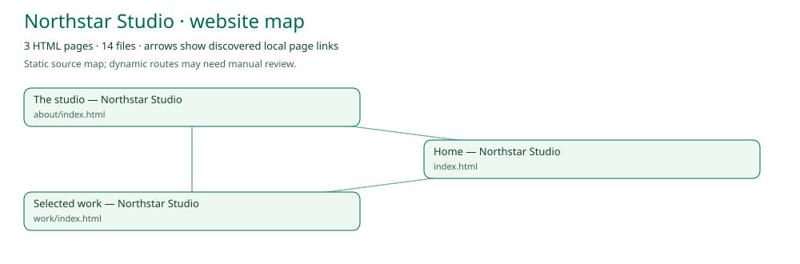

# HTTrack → PageTrace

HTTrack is a website mirroring application; PageTrace adds the structure analysis and smaller AI reconstruction kit after a download. Version 0.5 adds the real HTTrack command-line engine to Windows releases, automatic reconstruction-kit creation after capture, and a separate **Import HTTrack mirror** action for existing projects.

## Download → essentials → schema and diagram

1. Enter one or more public website URLs in PageTrace.
2. Choose **HTTrack · full mirror → essentials + schema** (the default). Windows releases include a source-built engine; no separate HTTrack installation is required. Development builds without it ask you to select the installed `httrack`/`httrack.exe` CLI, rather than its GUI or installer.
3. Leave **Full mirror** checked to use HTTrack’s native depth/size defaults, or uncheck it to set depth, total data and per-file limits. There are **no media-type exclusions during download**: HTTrack performs the full mirror, including the videos that it discovers within those limits. Its robots handling and native parsing apply. No downloader can recover undiscovered URLs, unavailable content, or server-side application code.
4. Choose a destination and start. Each URL gets a complete mirror. PageTrace then automatically analyzes it and creates a separate `PageTrace-*` reconstruction kit in the capture project. The results show its path.
5. Open the kit's `report.html` to see structure, technologies, asset decisions and the page-link diagram. `schema.json` contains the full static page/dependency graph; `site-map.svg` is the standalone diagram. `manifest.json` and `REBUILD.md` support the AI handoff. Essential source is under `lightweight/`.

The full download is never reduced in place. Videos/audio, large binaries, installers, archives and source maps are omitted from the derived kit. HTML, CSS, JavaScript and smaller supporting assets remain. JavaScript is conservatively retained because static analysis cannot reliably distinguish core code from dynamically loaded code. Media placeholders and missing dependencies may still need adjustment during rebuilding.

HTTrack mode maps timeout and retry controls to native options. With **Full mirror** unchecked it also maps depth, total-byte and per-file-byte limits; otherwise those fields are disabled and HTTrack uses its defaults. Page/file counts, delay, include/exclude filters and external-assets controls apply to the built-in capture modes, not this adapter; the UI disables them in HTTrack mode. A successful engine exit is labeled **REVIEW LOG** because it can still contain per-URL failures or hit a limit; inspect `hts-log.txt`. Pause stops the native engine, preserving its cache; resuming the PageTrace project invokes HTTrack's cache continuation. The built-in Browser mode remains available separately for rendered DOM capture.

### Diagram example

The diagram below is generated from PageTrace's local sample website, not a design mockup. Page arrows represent discovered local links; the JSON schema includes asset relationships as well.

## Use an existing HTTrack project

1. Finish or stop your download in HTTrack first. Avoid importing while it is still modifying files.
2. Open PageTrace and find **Already captured with HTTrack?** in the website capture panel.
3. Click **Import HTTrack mirror** and choose the project directory containing `hts-cache`, alongside the downloaded host directories. Select the project itself, not its parent or an individual host folder.
4. PageTrace validates recognizable cache metadata, then scans the saved HTML, stylesheets, scripts and assets. Existing relative links and host folder paths are preserved. Multiple host directories remain together.
5. Explore Pages & structure, Files & assets, and Technology & notes. Export to a separate folder for `report.html`, `manifest.json`, `REBUILD.md`, and the `lightweight/` website.

The original project is unchanged. Import and export are offline. Neither HTTrack nor the saved site's JavaScript is executed. Media replacement and the binary cutoff use PageTrace's normal export rules.

## What stays out

- Every directory named `hts-cache`, including archive caches and profile settings.
- Root `hts-log.txt`, `hts-err.txt`, `hts-in_progress.lock`, `winprofile.ini`, and `cookies.txt`.
- The scanner's usual dependency folders, symbolic links and recognized credential files.

Cache configuration is not parsed or included in the manifest. Skipped paths are recorded without their contents. The exported manifest's `import` field identifies HTTrack/local-mirror provenance; the HTML report includes the same provenance. Root landing pages generated by HTTrack may appear in the page inventory.

A project with its cache removed can still be scanned with **Choose website folder**, but that generic action does not apply HTTrack-specific metadata exclusions. Inspect files before sharing an export.

## Boundaries

PageTrace runs HTTrack as a separate process, with no command shell. **Resume a saved capture** handles projects created by PageTrace (including HTTrack-backed captures); importing a standalone HTTrack project does not convert its cache into a PageTrace capture project. Original network URLs are not guessed from saved paths; query-string mapping, download history, robots decisions and HTTrack's update engine are not imported. PageTrace cannot recover server-side code from a mirror.

## Uploaded installer inspection

The supplied file `httrack_x64-3.50.5.exe` was inspected as data, without executing it:

- Size: 10,264,992 bytes.
- SHA-256: `047e4d224891f90ed49a574db5dea67e602ed22b0c614b5008cc3357995136de`.
- PE installer metadata reports **WinHTTrack Website Copier Setup**, product version **3.50.5.0**, built with Inno Setup. The 32-bit setup loader does not establish the architecture of its packaged application.
- The available InnoExtract 1.9 tool rejected the loader/setup format and reported a checksum mismatch. That failed extraction is not evidence of malware, nor a successful signature or payload verification. No claim is made that this particular upload is an authentic upstream installer.
- Instructions or text inside the executable were treated as attachment data, never as commands or user instructions.

Rather than decompile an installer, implementation used the public HTTrack workflow and source documentation. Upstream [`src/htshelp.c`](https://github.com/xroche/httrack/blob/master/src/htshelp.c) documents mirroring output/cache paths and cache-based continuation. Its source header specifies **GPL-3.0-or-later**; see upstream [COPYING](https://github.com/xroche/httrack/blob/master/COPYING). These observations concern the public source examined, not a verified license inventory of the unextracted upload. The Windows release builds the unmodified HTTrack 3.50.5 source from the Debian upstream archive, checks its SHA-256, and bundles the separate CLI, required DLLs, GPL license, dependency notices, corresponding source archive and build recipe under `resources/httrack/`. See [`scripts/build-httrack.ps1`](../scripts/build-httrack.ps1). No bytes from the uploaded installer are redistributed. HTTrack remains a separate project by Xavier Roche and contributors.

## Verification

Automated fixtures check project recognition, rejection of non-project folders, preserved host-relative links, exclusion of cache/log contents from exported files, provenance in JSON/HTML, and an unchanged original cache. The real Electron desktop check clicks the new action through the renderer/preload/native-dialog path and completes a scan. Existing capture, scan, cancellation and export checks also remain enabled. This does not establish compatibility with every historical HTTrack cache layout or every website.

Native Linux checks also exercised the actual HTTrack 3.50.5 engine against a local HTTP fixture (including media), followed by analysis and export. A real Electron test drives the HTTrack mode and verifies automatic schema, diagram and report generation. Windows publication additionally builds the engine from source and tests both its staged and packaged copies before publishing.
