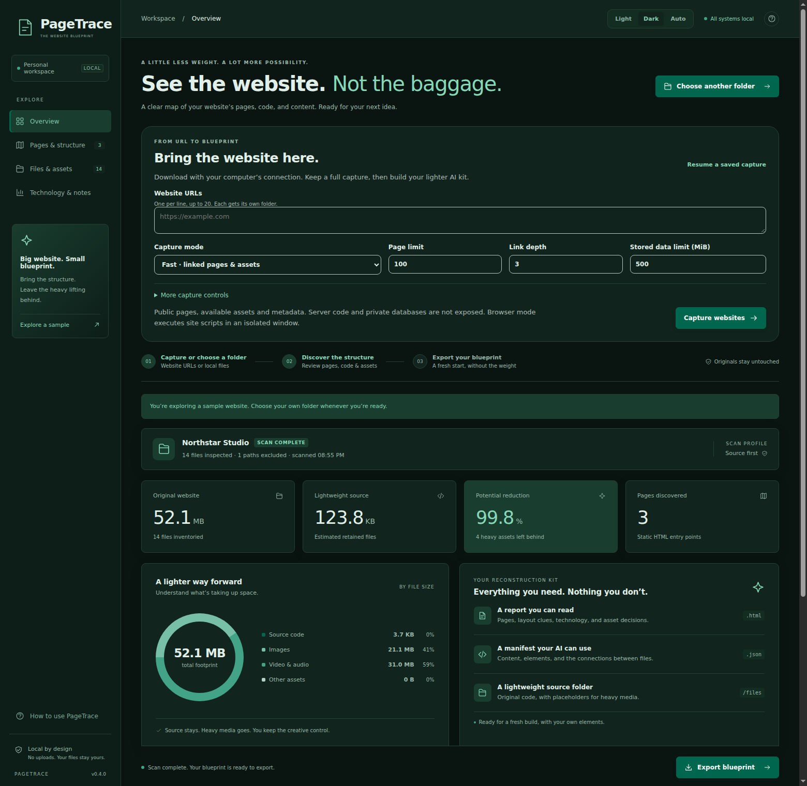
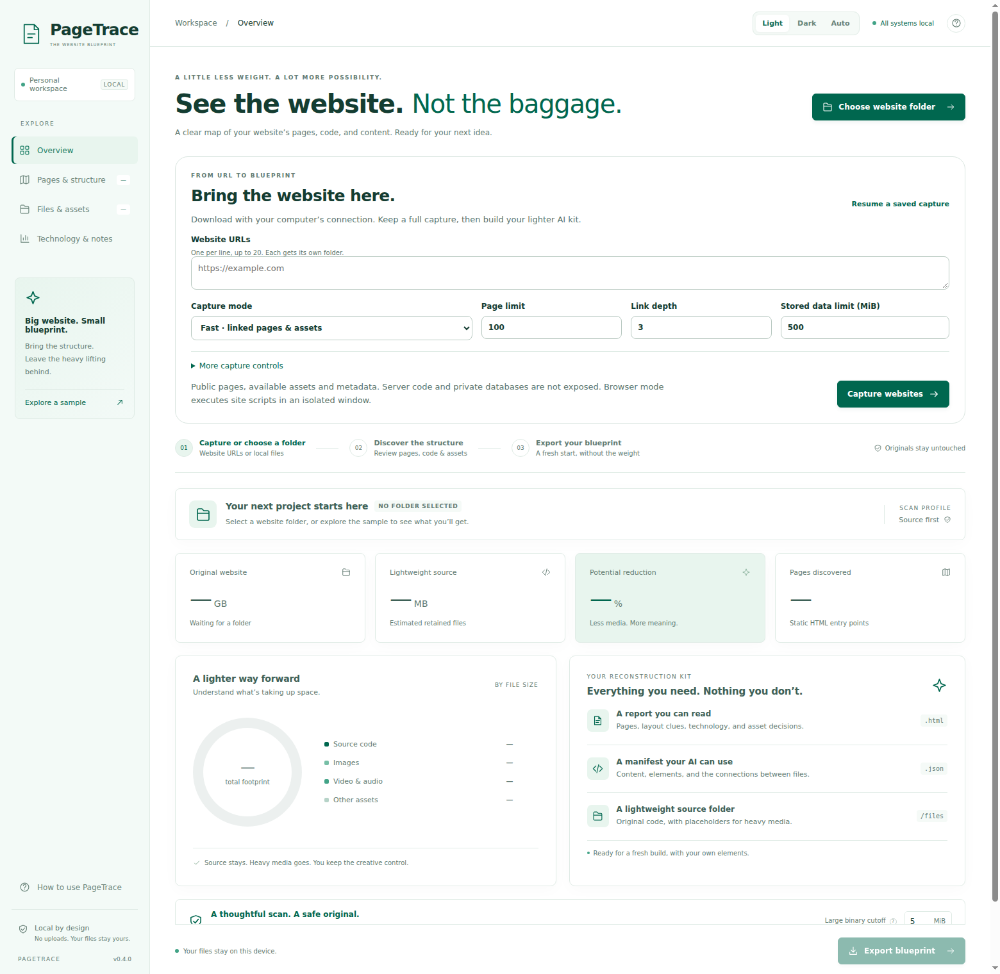
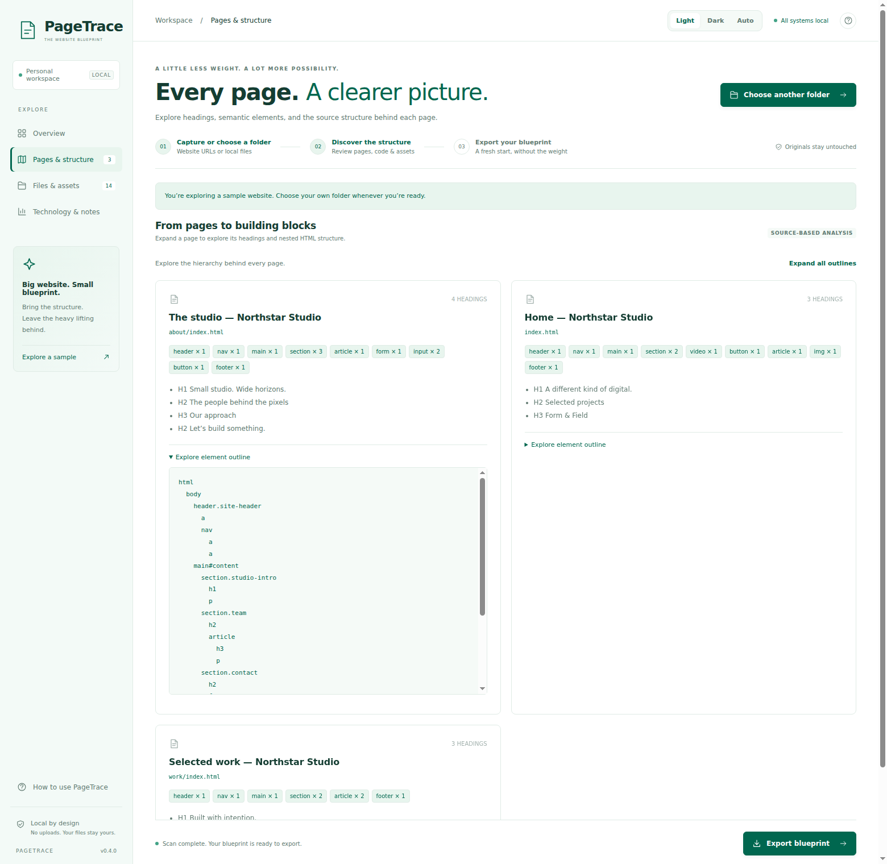
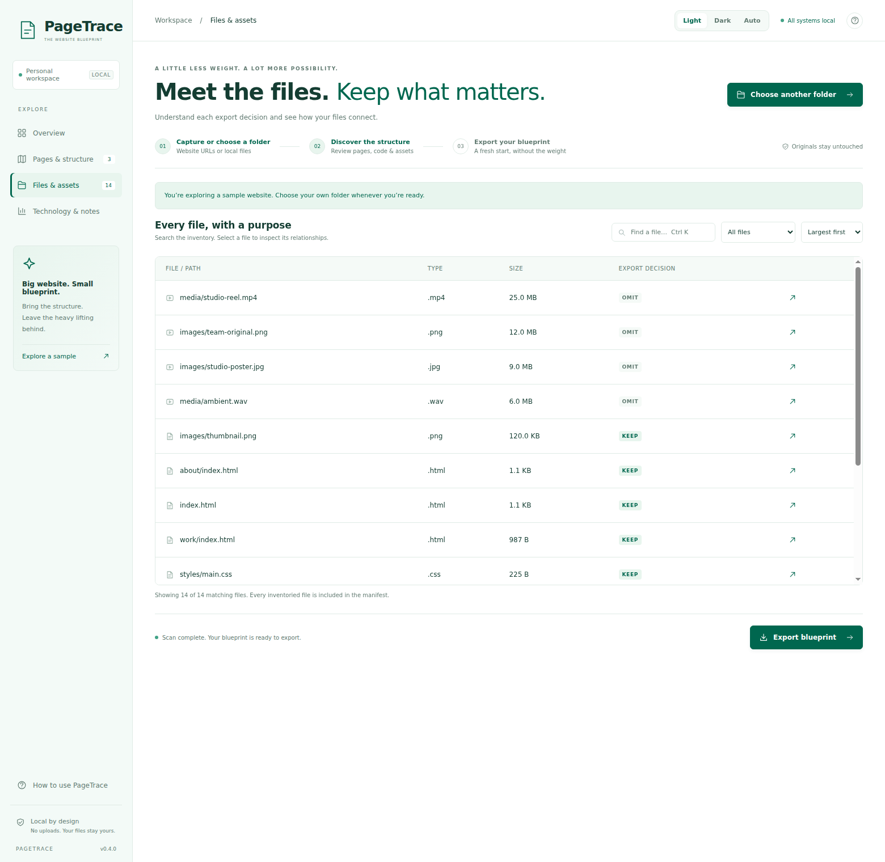
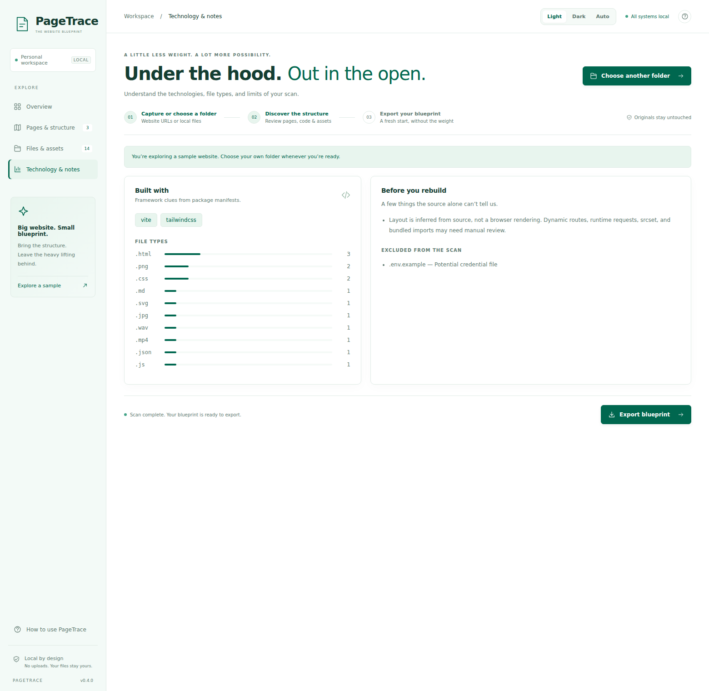
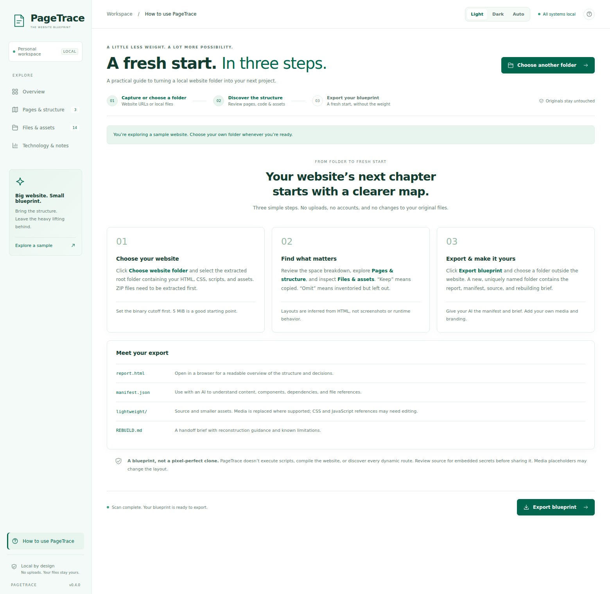
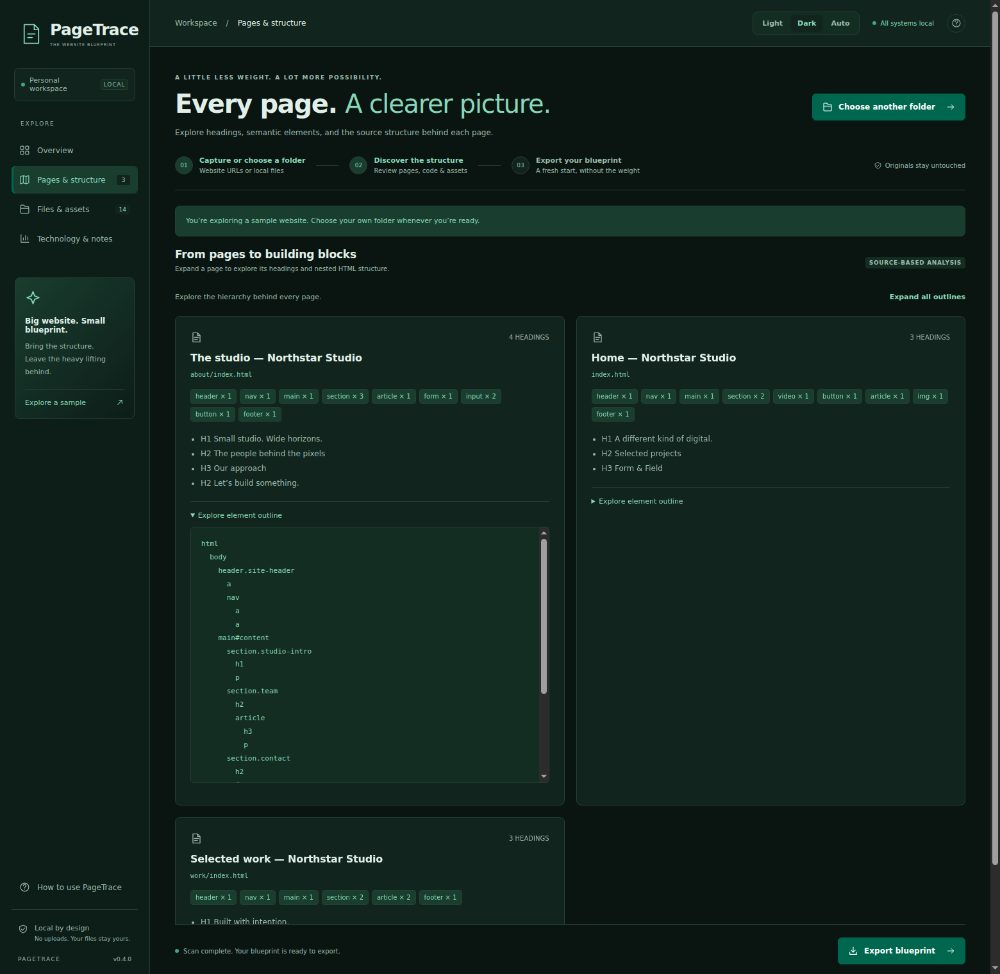
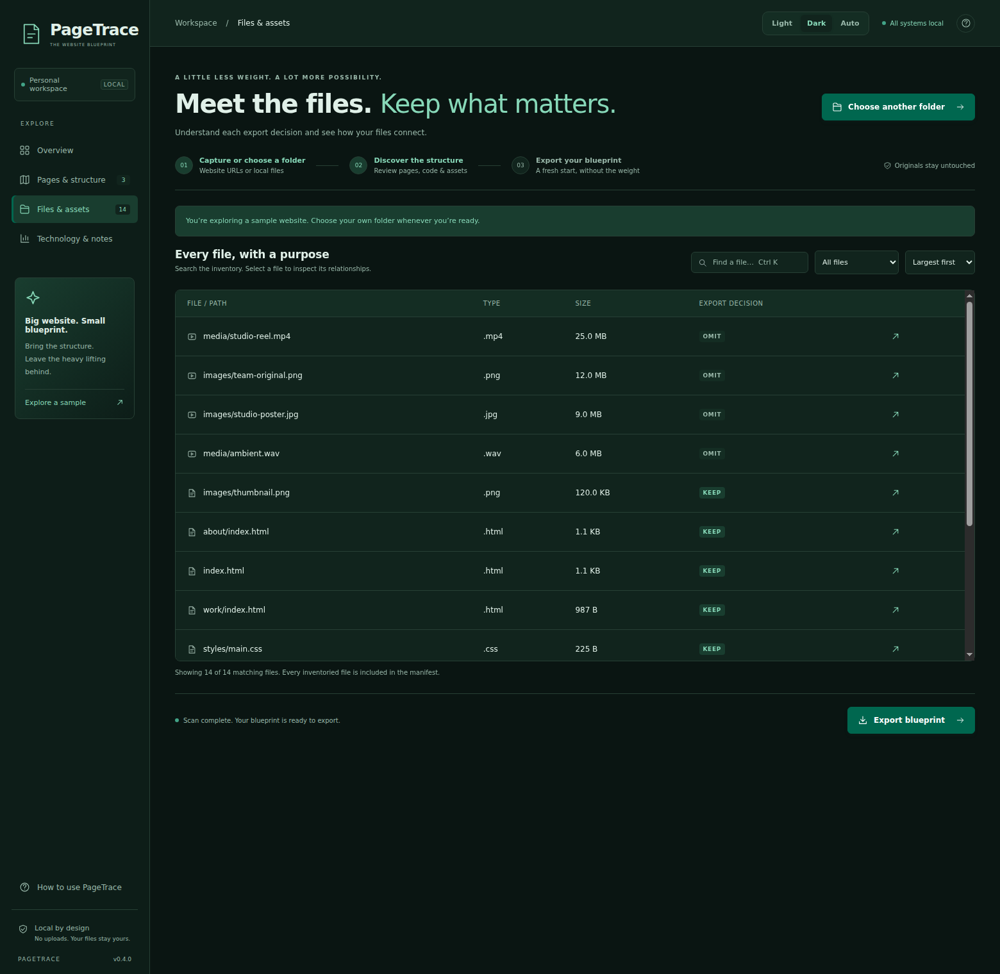
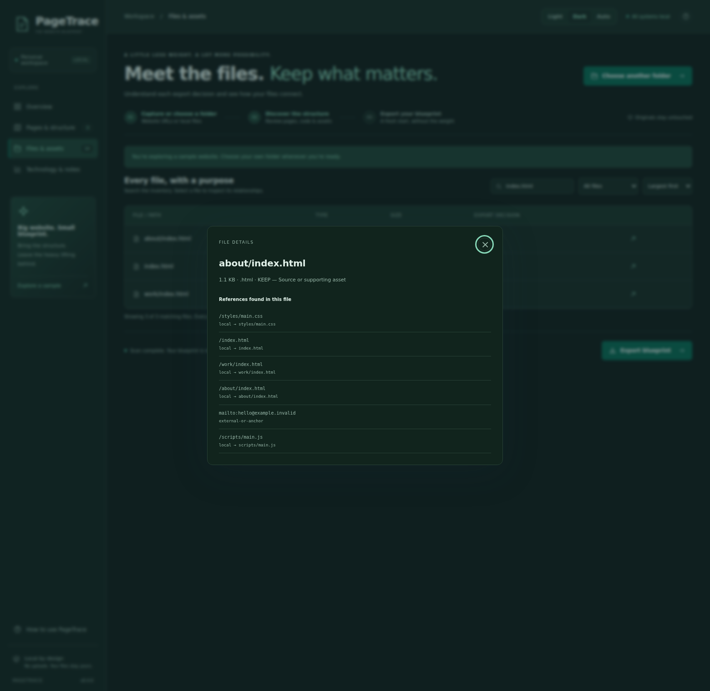

# A visual guide to PageTrace

**New in 0.4:** [Capture websites directly](CAPTURE.md), including multiple URLs, browser-rendered pages, saved project resume and full original downloads. After capture, select a site to analyze using the workflow below.

PageTrace turns a local website folder into a readable report, an AI-ready manifest, and a smaller source copy. Everything happens on your computer. The original folder stays untouched.

## Appearance and keyboard controls

The PageTrace accent is **`#00674F`**. Use the top-right **Light / Dark / Auto** control at any time. Light uses white surfaces; Dark uses deep-green surfaces and brighter emerald text accents. Auto follows your device. The preference is saved locally, including across app restarts.

| Shortcut                                    | Action                                |
| ------------------------------------------- | ------------------------------------- |
| Ctrl + K (Cmd + K on macOS)                 | Open Files & assets and focus search. |
| Ctrl + Shift + L (Cmd + Shift + L on macOS) | Switch between light and dark.        |
| Escape                                      | Close the file inspector.             |

## 1. Start with a folder

1. Extract your website ZIP first, if necessary.
2. Open PageTrace and click **Choose website folder**.
3. Select the website’s root folder: the folder containing its pages, styles, scripts, and assets.
4. Wait for the scan. The progress panel shows files inspected and bytes inventoried; **Cancel scan** stops the operation.

The **Large binary cutoff** is 5 MiB by default. Change it **before** scanning. Videos and audio are always omitted from the lightweight export; other binary assets are omitted above the cutoff. Source files are kept regardless of size. This setting does not delete or compress anything in your original website.

Want to learn without using your own files? Click **Explore a sample** in the sidebar. It creates an example site locally with sparse, non-playable media fixtures and scans it using the same engine. The example is clearly labeled and removed when the app exits.

## 2. Read the overview

The screenshot shows the built-in **Northstar Studio** example, not a real customer website. Its media fixtures are sparse files; the scanner measures them without loading their content.

- **Original website:** bytes in the inventoried files. Excluded paths are not included.
- **Lightweight source:** estimated bytes in files selected to be copied. Reports, manifest, and placeholder overhead are added during export.
- **Potential reduction:** the difference between inventoried and retained file sizes. Very high reductions are displayed conservatively as 99.9% rather than rounding to 100%.
- **Pages discovered:** static HTML entry points; this is not a count of every possible dynamic route.

The chart groups bytes into source, images, video/audio, and other assets. The reconstruction-kit card explains the three main outputs. You can still switch folders before exporting.

## 3. Explore pages and layout

Open **Pages & structure** to see page titles, relative paths, headings, and semantic elements such as headers, navigation, forms, and sections.

Use **Expand all outlines / Collapse all outlines** to inspect several pages together. Click **Explore element outline** to expand a single nested HTML tree. IDs and CSS classes are included to help an AI understand how the page is assembled. These are source clues, not a rendered browser layout. Source files above 2 MiB are not parsed. Very large outlines are capped; the manifest marks truncated layouts.

## 4. Inspect files and assets

Open **Files & assets** to search by path, filter by **Keep in export** / **Omit from export**, and sort by **Path A–Z**, **Largest first**, or **Smallest first**. Sorting and filtering affect the view, not the exported decisions.

- **KEEP:** copied to the lightweight folder.
- **OMIT:** inventoried in the manifest, but not copied.
- Use the arrow on a row to inspect the decision reason and references found in that file.
- References distinguish local targets, unresolved paths, and external URLs/anchors. During analysis, external URLs are recorded without fetching. The separate capture stage fetches permitted URLs.

The interface displays up to 500 matching rows at a time to stay responsive. The manifest contains every inventoried file. It is not a tool for selecting individual custom omissions in this version.

## 5. Check technology and notes

**Technology & notes** shows framework clues from `package.json`, file-extension counts, analysis limitations, and excluded paths. No package installation or website code execution is performed by the scanner.

Common secret filenames, symlinks, dependency folders, and caches are excluded. This is **not a general secret detector**. Read the source before sending an export to an AI or another person.

## 6. Export a blueprint

Click **Export blueprint** at the bottom of the window and select a destination **outside your original website folder**. A uniquely named `PageTrace-*` directory is created there; existing exports are not overwritten. Use **Open export folder** after export to view it in Explorer.

| Output                                            | How to use it                                                                                                             |
| ------------------------------------------------- | ------------------------------------------------------------------------------------------------------------------------- |
| `report.html`                                     | Open in your browser for page structure, element outlines, technology clues, decisions, exclusions, and warnings.         |
| `manifest.json`                                   | Give to an AI as structured context: files, sizes, content excerpts, headings, elements, references, and framework clues. |
| `lightweight/`                                    | A separate source copy with retained assets and media placeholders where supported.                                       |
| `lightweight/.pagetrace-*/PAGETRACE-OMITTED.json` | A checklist of media to replace with your own elements.                                                                   |
| `REBUILD.md`                                      | A reconstruction handoff brief with limitations and next steps.                                                           |

Video/audio HTML elements and supported `src`/`poster` references receive placeholders. CSS, JavaScript, `srcset`, and runtime-generated references may still need manual changes. The app does not guarantee a working, pixel-identical website. The analysis/export stages do not compile or execute the original site; optional browser capture runs scripts in a separate sandbox.

If any files changed or became unreadable between scanning and export, a warning appears and the report lists the affected paths. Review those warnings and rescan a stable copy before relying on the export.

## 7. Get help inside the app

Click **How to use PageTrace** in the sidebar or the question-mark button at the top. The guide is included in the executable and works completely offline.

## Windows installation

- **Installer:** run `PageTrace-0.3.0-x64-Setup.exe`, choose an install location, and launch from the Start menu or desktop shortcut.
- **Portable:** run `PageTrace-0.3.0-x64-portable.exe`. No Node.js or separate Electron installation is needed. It extracts its runtime to a temporary directory while running.
- Windows 10/11 **64-bit** is the target. ARM and 32-bit Windows are not included.
- Builds are unsigned. Windows may show an unknown-publisher or SmartScreen prompt. Verify where you downloaded the executable and its checksum. A signing certificate is not included.

[Download the portable Windows executable](https://github.com/Sam4d/Manifest/releases/latest/download/PageTrace-Windows-x64.exe), or open [Releases](https://github.com/Sam4d/Manifest/releases/latest) for the installer and SHA-256 checksums. Each new version is published after successful native Windows checks and packaging. The download is named `PageTrace-Windows-x64.exe` for a stable direct link.

## Troubleshooting

| Situation                           | What to do                                                                                                                                     |
| ----------------------------------- | ---------------------------------------------------------------------------------------------------------------------------------------------- |
| No HTML pages found                 | Your website may be component-based or dynamically routed. Inspect its source in Files & assets; static HTML parsing cannot infer every route. |
| Export destination rejected         | Choose a folder outside the source tree, such as a sibling `Exports` directory.                                                                |
| Unexpectedly large lightweight copy | Source is always retained. Lower the binary cutoff and rescan to omit more non-source assets.                                                  |
| Missing image or media in the copy  | Check the omitted-assets checklist and replace it with your own media. Dynamic references may need editing.                                    |
| Export warning about changed files  | Stop changes to the source, rescan, then export again.                                                                                         |
| CI fails on Linux desktop startup   | The CI-only smoke script handles restricted Chromium namespaces and uses Xvfb. Normal desktop launches keep the sandbox enabled.               |

Screenshots are captured from the real Electron interface with generated sample content using `npm run test:desktop:ci -- --screenshots` on a virtual Linux display. They are not concept mockups.

## Dark-mode walkthrough

Every major screen follows the same saved appearance setting. Toggle modes without rescanning or losing your current inventory.

The page outline stays readable in dark mode and can be expanded for each page or all pages together.

Search, sort, and decision filters continue to work across themes. The inventory is not modified by changing appearance.

Select the arrow beside a file to see its reason and references. Press Escape or use the close button to return to the inventory.

## Upgrading from earlier names

Earlier builds were named SiteAtlas/SiteSieve. PageTrace uses its own application identity and stored appearance setting. Your original website folders and previous exports are unaffected. You can uninstall the older app separately; exports remain ordinary folders you control.

For technical details, read the [architecture guide](ARCHITECTURE.md) and [manifest reference](MANIFEST.md).
